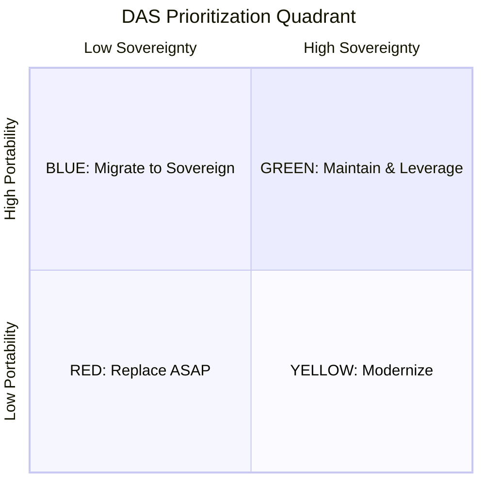

# Digital Autonomy Score (DAS)

A practical, repeatable methodology for assessing the **digital sovereignty** and **portability** of technology systems.

## What is DAS?

DAS produces two scores for any technology component or system:

### Sovereignty (S) — *Can a foreign entity control, restrict, or compel access to your technology?*

Digital sovereignty measures the degree to which an organisation retains autonomous control over a technology system — free from foreign legal compulsion, single-vendor dependency, or external governance capture. It is assessed across three sub-dimensions:

- **S1 — Legal & Jurisdictional Exposure**: Where is data stored and processed? Which legal framework governs the vendor relationship? A system hosted by a US company falls under the CLOUD Act, meaning a foreign government can compel access to your data regardless of where the servers sit physically.
- **S2 — Technical Autonomy**: Can you run, modify, and maintain the technology independently? A proprietary SaaS with no source access and no self-hosting option leaves you entirely dependent on the vendor's continuity and goodwill. Open-source with copyleft licensing scores higher than permissive licensing because it structurally prevents proprietary capture.
- **S3 — Governance Independence**: Who controls the technology's roadmap and evolution? A project governed by a single US corporation carries different risks than one governed by an EU foundation or an international standards body. Governance determines whether the technology can be steered away from your interests.

The sovereignty score ranges from **0** (proprietary system under foreign legal jurisdiction with no autonomy) to **10** (ratified international standard with multilateral governance and multiple independent implementations). Legal exposure is weighted highest (40%) because legal compulsion can override all technical safeguards.

### Composite Portability Score (CPS) — *Can you leave?*

Portability measures the practical feasibility of moving a system to a different provider, platform, or infrastructure. Code portability alone is misleading — a containerised application that depends on a vendor-locked database creates an *illusion* of portability. CPS therefore assesses five sub-dimensions:

- **P1 — Code/Runtime Portability**: Can the software run on a different platform? Ranges from hardware-locked firmware (0) to universal standards like ANSI C or POSIX shell (10).
- **P2 — Data Portability** *(highest weight — 30%)*: Can you get your data out, completely, in a format others can use? Data gravity is the primary lock-in vector. A system with perfectly portable code but locked-in data is not portable.
- **P3 — API/Integration Portability**: Do integrations use standard protocols (SMTP, SQL, OAuth2), or are you tied to vendor-specific SDKs and query languages?
- **P4 — Operational Portability**: Can you actually run this somewhere else? Are the skills, tooling, and alternative providers available? A SaaS-only product with no self-hosting option scores 0.
- **P5 — Migration Feasibility**: What is the practical effort, timeline, and risk to move? Ranges from impossible (0) to no migration needed (10).

The CPS ranges from **0** (immovable) to **10** (environment-independent). For composite systems (stacks with multiple layers), DAS applies the **weakest-link principle**: the system score for each dimension is the minimum across all layers, because a system with a portable frontend but a locked-in database can only migrate if the database can migrate. If any sub-dimension scores 2 or below, CPS is capped at 4 regardless of other strengths.

### The Prioritization Quadrant

These two scores place the system on a **prioritization quadrant** that drives action:



## Quick Start

Answer three questions about your system:

1. **Can you export ALL data today, in a standard format, without the vendor?** No → CPS ≤ 3
2. **Are there ≥ 3 independent EU service providers for this?** No → CPS ≤ 5
3. **Could your team migrate in < 12 months with existing budget?** No → CPS ≤ 6

## How to Use DAS

### Quick Assessment (30 minutes)

1. Read [assessment-process.md](assessment/assessment-process.md), Phase 2
2. Answer the three ceiling questions for your system
3. Place on the quadrant using [quadrant-and-actions.md](assessment/quadrant-and-actions.md)
4. Determine immediate action

### Thorough Assessment (half-day per system)

1. Follow all five phases in [assessment-process.md](assessment/assessment-process.md)
2. Use the detailed rubrics in [sovereignty-scale.md](assessment/sovereignty-scale.md) and [portability-scale.md](assessment/portability-scale.md)
3. Score each layer and sub-dimension
4. Place on the quadrant and develop action plans per [quadrant-and-actions.md](assessment/quadrant-and-actions.md)
5. Calibrate your scores against [reference-assessments.md](assessment/reference-assessments.md)

### Automated Assessment with Claude Code

This repository is also a **Claude Code plugin**. Install it and run `/das` to get an automated assessment of any codebase:

1. Install the plugin: `claude plugin add /path/to/digital-autonomy-score`
2. Navigate to the codebase you want to assess
3. Run `/das` — the agent will interview you about business context, scan the codebase, score all dimensions, and produce a full report with quadrant placement, Mermaid chart, Wardley Map, and recommended actions

You can also point it at a remote repo: `/das https://github.com/org/repo`

Run `/seal` for the complementary **EU Cloud Sovereignty Framework** assessment (see below). At the end of a `/das` run, the agent also offers it as an add-on.

## EU Cloud Sovereignty Framework (SEAL)

DAS is complemented by an assessment aligned with the **European Commission's Cloud Sovereignty Framework v1.2.1 (Oct. 2025)**. Where the DAS Sovereignty (S) score answers *"can a foreign entity control or compel access?"* on a 0–10 scale, the SEAL assessment scores a system against the Commission's **eight Sovereignty Objectives**, each on a five-level assurance scale:

| | Sovereignty Objectives | SEAL levels |
|---|---|---|
| What | SOV-1 Strategic · SOV-2 Legal & Jurisdictional · SOV-3 Data & AI · SOV-4 Operational · SOV-5 Supply Chain · SOV-6 Technology · SOV-7 Security & Compliance · SOV-8 Environmental | SEAL-0 No Sovereignty → SEAL-1 Jurisdictional → SEAL-2 Data → SEAL-3 Digital Resilience → SEAL-4 Full Digital Sovereignty |

The `/seal` command (or the add-on offered at the end of `/das`) produces:

- a **SEAL level (0–4)** per objective, with evidence and confidence;
- an adapted weighted **Sovereignty Score (%)** — `Σ (SEALₙ/4) × Weightₙ` (the framework's tender-question points are substituted by the assessed SEAL level);
- the **minimum SEAL** across objectives (the framework's Minimum Assurance Level); and
- **recommendations to raise each objective's SEAL level** by one step.

This **complements — it does not replace —** the DAS score. Notably, **Supply Chain (SOV-5), Security & Compliance (SOV-7), and Environmental Sustainability (SOV-8)** are dimensions the DAS S/P scores do not cover. The methodology is documented in [seal-framework.md](assessment/seal-framework.md).

```
/seal                              # assess the current directory
/seal ./path/to/project            # assess a local path
/seal https://github.com/org/repo  # clone and assess a remote repo
```

## Document Index

| Document | Description |
|----------|-------------|
| [sovereignty-scale.md](assessment/sovereignty-scale.md) | Sovereignty scoring with 0–10 scale and three sub-dimensions (S1–S3) |
| [portability-scale.md](assessment/portability-scale.md) | Portability scoring with five sub-dimensions (P1–P5), composite formula, and weakest-link principle |
| [assessment-process.md](assessment/assessment-process.md) | Step-by-step guide: scope & inventory, quick screening, detailed scoring, quadrant placement, recommendations |
| [quadrant-and-actions.md](assessment/quadrant-and-actions.md) | Prioritization matrix with detailed action playbooks per quadrant |
| [reference-assessments.md](assessment/reference-assessments.md) | Worked examples of well-known technology stacks scored under the framework |
| [automated-signals.md](assessment/automated-signals.md) | Machine-detectable signals for each sub-dimension, specification for future DAS sub-agent |
| [seal-framework.md](assessment/seal-framework.md) | EU Cloud Sovereignty Framework methodology — 8 Sovereignty Objectives, SEAL levels, adapted scoring (complement to the S-scale) |

## Wardley Mapping Integration

DAS assessments include a **Wardley Map** alongside the quadrant chart. [Wardley Maps](https://wardleymaps.com) visualise the value chain of a system — from user needs down through application components to infrastructure — and position each component along an evolution axis from Genesis (novel, custom-built) to Commodity (standardised, ubiquitous).

In a DAS context, Wardley Maps serve three purposes:

1. **Identify what to assess** — Map the system's value chain first, then run DAS on each component. This prevents blind spots: you score what matters to the user, not just what's technically visible.
2. **Visualise sovereignty risk** — Components with low sovereignty scores (S ≤ 3) are annotated with risk notes and `evolve` arrows showing the desired migration target. The map makes it immediately clear where foreign-controlled dependencies sit in your value chain.
3. **Plan migration sequencing** — The dependency links on the map reveal which components must migrate first. A database migration must happen before the application layer can move — the map makes this constraint visible.

DAS generates Wardley Maps in [OWM (Online Wardley Maps)](https://onlinewardleymaps.com) syntax, which can be pasted directly into the renderer to produce an interactive map.

## Other Complementary Tools

DAS also complements Core Domain Charts (to prioritize business-critical systems for assessment) and Architecture Decision Records (to document the decisions made based on DAS results).

## Author

**Cédric Pontet** — CTO at [Agile Partner](https://www.agilepartner.net/), Luxembourg.

## License

This work is licensed under [Creative Commons Attribution-ShareAlike 4.0 International (CC BY-SA 4.0)](https://creativecommons.org/licenses/by-sa/4.0/).

[Wardley Mapping](https://wardleymaps.com) is courtesy of Simon Wardley, CC BY-SA 4.0.
