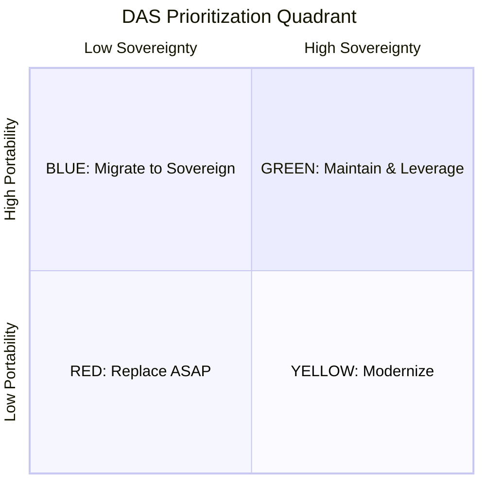

# Digital Autonomy Score (DAS)

A practical framework for assessing the **digital sovereignty** and **portability** of technology systems, born from the research and presentation [*Geopolitics and Digital Sovereignty: Stakes, Implications, and Opportunities*](docs/content/README.md) by Cédric Pontet.

## What is DAS?

DAS produces two scores for any technology component or system:

- **Sovereignty (S)** — How exposed is this system to foreign legal compulsion, vendor lock-in, or governance capture? *(0 = fully dependent, 10 = ratified international standard)*
- **Composite Portability Score (CPS)** — How feasible is it to move this system to a different provider, platform, or infrastructure? *(0 = immovable, 10 = environment-independent)*

These two scores place the system on a **prioritization quadrant** that drives action:



## Quick Start

Answer three questions about your system:

1. **Can you export ALL data today, in a standard format, without the vendor?** No → CPS ≤ 3
2. **Are there ≥ 3 independent EU service providers for this?** No → CPS ≤ 5
3. **Could your team migrate in < 12 months with existing budget?** No → CPS ≤ 6

For the full methodology, see the [DAS Assessment Framework](docs/assessment/README.md).

## Repository Structure

```
docs/
├── assessment/                  # DAS framework
│   ├── README.md                  Framework overview & usage guide
│   ├── sovereignty-scale.md       Sovereignty scoring (S1–S3 sub-dimensions)
│   ├── portability-scale.md       Portability scoring (P1–P5 sub-dimensions)
│   ├── assessment-process.md      Step-by-step assessment process
│   ├── quadrant-and-actions.md    Prioritization quadrant & action playbooks
│   ├── reference-assessments.md   Calibration examples (8 worked assessments)
│   └── automated-signals.md       Machine-detectable signals for automated scoring
│
├── content/                     # Research & presentation
│   ├── README.md                  Table of contents
│   └── 01–13-*.md                 13 chapters covering geopolitics, EU dependency,
│                                  regulation, alternatives, and assessment tools
│
└── *.pdf, *.pptx, *.docx       # Original presentation materials (French)
```

## Key Insights

**Why not just use the original 0–10 scales?** The original scales from the presentation have logical issues that DAS corrects:

- **GPL scores higher than MIT** — Copyleft licenses *prevent proprietary capture*, so they score 7–8 for sovereignty vs. 5–6 for permissive. The original had this inverted.
- **Docker is not portability** — A containerized vendor-locked app is not portable. DAS scores the *contents*, not the shipping box.
- **Data gravity is king** — Data portability is weighted 2× over code portability (0.30 vs. 0.15), because data is the primary lock-in vector.
- **Weakest link wins** — A system with a portable frontend but a locked-in database scores based on the database. System score = minimum across layers.

## Author

**Cédric Pontet** — CTO at [Agile Partner](https://www.agilepartner.net/), Luxembourg. Originally presented at Voxxed Days Luxembourg.

## License

This work is licensed under [Creative Commons Attribution-ShareAlike 4.0 International (CC BY-SA 4.0)](https://creativecommons.org/licenses/by-sa/4.0/).

[Wardley Mapping](https://wardleymaps.com) is courtesy of Simon Wardley, CC BY-SA 4.0.
