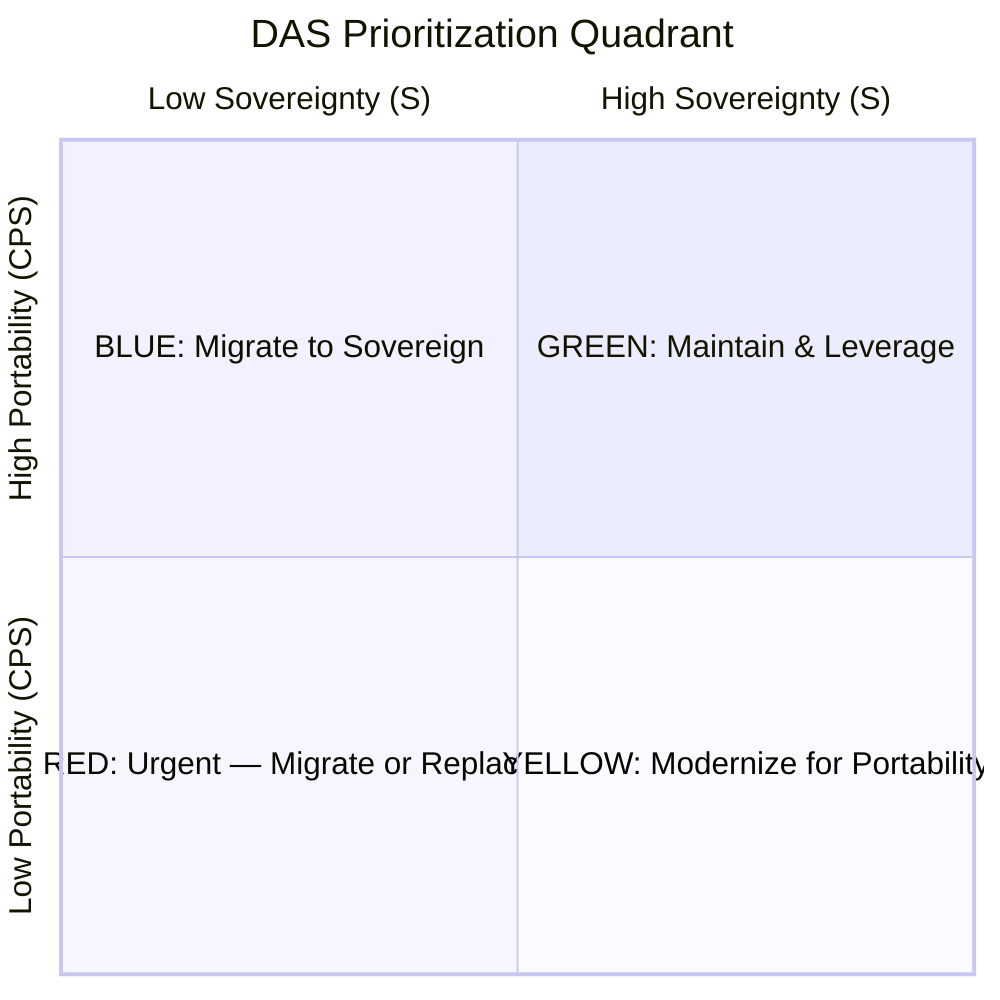

# DAS Prioritization Quadrant & Action Playbooks

## The Quadrant

The sovereignty × portability quadrant maps every assessed system into one of four zones, each with a distinct strategic posture.

**Threshold**: The midpoint at 5 divides the quadrants. Systems scoring exactly 5 on either axis should be treated as borderline and assessed in context.

---

## Green Quadrant: Sovereign & Portable (S ≥ 5, CPS ≥ 5)

**Status:** Best case — "Don't break what works"

**Posture:** Maintain and leverage

### Characteristics
- Open-source or open-standard-based technology
- Hosted on EU/sovereign infrastructure
- Data in standard formats with export capability
- Multiple service providers available
- Strong community or foundation governance

### Action Playbook

**Immediate (0–3 months):**
- Document current architecture and dependencies as a reference pattern
- Ensure operational runbooks and disaster recovery are up to date
- Verify that data export/backup procedures are tested regularly

**Ongoing:**
- Monitor governance changes (foundation moves, license changes, acquisition risks)
- Use this system as a template for migrating Red/Blue systems
- Contribute upstream where strategically relevant (influence roadmap)
- Re-assess annually or when major version changes occur

**Watch for:**
- License changes (e.g., Redis, Elasticsearch, HashiCorp precedents)
- Foundation governance shifts
- Consolidation of maintainer community
- Dependency chain changes that might introduce non-sovereign components

### Examples
- PostgreSQL on EU cloud (S=8, CPS=7)
- Self-hosted GitLab CE (S=6, CPS=6)
- Nextcloud on own infrastructure (S=8, CPS=7)

---

## Blue Quadrant: Portable but Not Sovereign (S < 5, CPS ≥ 5)

**Status:** Low-hanging fruit — "Move ASAP"

**Posture:** Migrate to sovereign alternatives

### Characteristics
- Technology itself is portable (open-source, standard formats, containers)
- But hosted on non-sovereign infrastructure (US cloud, CLOUD Act jurisdiction)
- Or governed by non-EU entities with concentration risk
- Migration is feasible because the technology is inherently portable

### Action Playbook

**Immediate (0–3 months):**
- Inventory hosting and infrastructure dependencies
- Identify EU sovereign cloud providers (OVHcloud, Scaleway, IONOS, T-Systems, etc.)
- Estimate migration effort and cost
- Begin contract negotiation for EU alternatives

**Short-term (3–12 months):**
- Execute infrastructure migration (often the simplest migration path)
- Migrate to EU-hosted managed services where available
- Update IaC and CI/CD pipelines for new providers
- Test thoroughly in new environment before cutover

**Long-term (12+ months):**
- Establish multi-cloud capability to prevent future single-provider lock-in
- Consider operational sovereignty: EU teams managing EU infrastructure

### Prioritization Within Blue
1. Systems processing regulated data (GDPR, NIS2, DORA)
2. Systems with upcoming contract renewals
3. Systems already running on portable technology (Docker, Kubernetes) — easiest to move

### Examples
- Kubernetes workloads on AWS → migrate to EU Kubernetes provider
- Docker containers on GCP → migrate to OVHcloud or Scaleway
- PostgreSQL on AWS RDS → migrate to EU-managed PostgreSQL (Aiven, Scaleway, etc.)

---

## Red Quadrant: Not Sovereign & Not Portable (S < 5, CPS < 5)

**Status:** Worst case — "Locked-in and at risk"

**Posture:** Urgent — migrate or replace

### Characteristics
- Proprietary, vendor-locked technology
- Non-EU jurisdiction with limited legal protections
- Data export difficult or impossible
- No viable alternative providers
- Migration is complex and expensive

### Action Playbook

**Immediate (0–3 months):**
- **Risk assessment**: Quantify the exposure (what happens if vendor cuts access, raises prices 10×, is sanctioned?)
- **Data preservation**: Begin extracting whatever data is exportable, even if incomplete
- **Contract review**: Understand lock-in terms, exit clauses, data portability commitments
- **Alternatives analysis**: Research sovereign alternatives for each layer

**Short-term (3–12 months):**
- **Develop migration plan**: Detailed technical plan with timeline, resources, and risk mitigation
- **Begin parallel development**: Start building or adopting alternative on sovereign stack
- **Data migration strategy**: Design ETL pipelines for data extraction and transformation
- **Stakeholder alignment**: Ensure business leadership understands urgency and costs

**Long-term (12–24+ months):**
- **Execute migration**: Phased migration with rollback capability
- **Decommission**: Retire legacy system only after full data verification
- **Lessons learned**: Document migration experience for similar future efforts

### Prioritization Within Red
1. **Critical systems with regulated data** — highest legal and operational risk
2. **Systems with imminent contract renewals** — use renewal as leverage/transition point
3. **Systems with known alternatives** — lower migration risk
4. **Core domain systems** — strategic importance justifies investment

### Warning Signs Requiring Emergency Action
- Vendor acquired by entity in adversarial jurisdiction
- Regulatory investigation or sanction proceedings against vendor
- Vendor announces end-of-life or dramatic price increase
- Data breach or compliance incident linked to vendor

### Examples
- Salesforce CRM with extensive custom objects (S=0, CPS=2)
- Microsoft 365 for document management (S=0, CPS=3)
- SAP S/4HANA on AWS (S=1, CPS=2)

---

## Yellow Quadrant: Sovereign but Not Portable (S ≥ 5, CPS < 5)

**Status:** Questionable — "Sovereign but brittle"

**Posture:** Modernize for portability

### Characteristics
- Technology is sovereign (EU vendor, open-source, EU-hosted)
- But tightly coupled to specific infrastructure or deployment patterns
- Data in proprietary formats or migration is impractical
- Single-vendor dependency (even if EU vendor)
- Operational knowledge concentrated in small team

### Action Playbook

**Immediate (0–3 months):**
- **Document current state**: Architecture, dependencies, operational procedures
- **Identify portability bottlenecks**: Which sub-dimension drags the score down?
- **Quick wins**: Enable standard data export, document APIs, adopt IaC

**Short-term (3–12 months):**
- **Containerize**: Package for standard deployment if not already done
- **Standardize interfaces**: Adopt standard APIs (REST, GraphQL, SMTP, CalDAV, etc.)
- **Data format migration**: Move to standard storage formats where possible
- **Multi-provider testing**: Verify deployment works on at least 2 providers

**Long-term (12+ months):**
- **Architecture modernization**: Decouple tightly-bound components
- **Operational maturity**: Cross-train team, improve documentation, adopt standard monitoring
- **Establish portability testing**: Regular "can we move this?" exercises

### Prioritization Within Yellow
1. Systems where the EU vendor itself has concentration risk (single person, startup)
2. Systems approaching end-of-life or major refactoring anyway
3. Systems where simple standardization (export, API, IaC) would quickly improve CPS

### Examples
- EU proprietary ERP on dedicated servers (S=6, CPS=3)
- Custom on-premises system built by internal team (S=7, CPS=3)
- EU SaaS with limited export capabilities (S=5, CPS=4)

---

## Cross-Quadrant Strategy

### Integration with Wardley Mapping

Use Wardley Maps to understand the evolutionary stage of each component:

| Evolution Stage | Sovereignty Approach |
|-----------------|---------------------|
| **Genesis** (novel) | Accept lower sovereignty for speed; plan future migration |
| **Custom** (emerging) | Invest in sovereign alternatives while market develops |
| **Product** (mature) | Sovereign alternatives likely exist; prioritize migration |
| **Commodity** (utility) | Sovereign options widely available; no excuse for non-sovereign choice |

### Integration with Core Domain Charts

| Domain Type | Investment Level |
|-------------|-----------------|
| **Core** (competitive advantage) | Highest investment in sovereignty + portability; consider in-house development |
| **Supporting** (necessary but not differentiating) | Standard sovereign solutions; managed services acceptable |
| **Generic** (commodity) | Off-the-shelf sovereign options; minimize operational overhead |

### Portfolio Transition Strategy

1. **Map all systems** on the quadrant
2. **Identify Blue quick-wins** — infrastructure migration with minimal application changes
3. **Address Red critical** — highest risk exposure, begin immediately
4. **Modernize Yellow** — include in regular architecture evolution
5. **Maintain Green** — protect and replicate the pattern
6. **Re-assess quarterly** — quadrant positions change as vendors, regulations, and alternatives evolve
