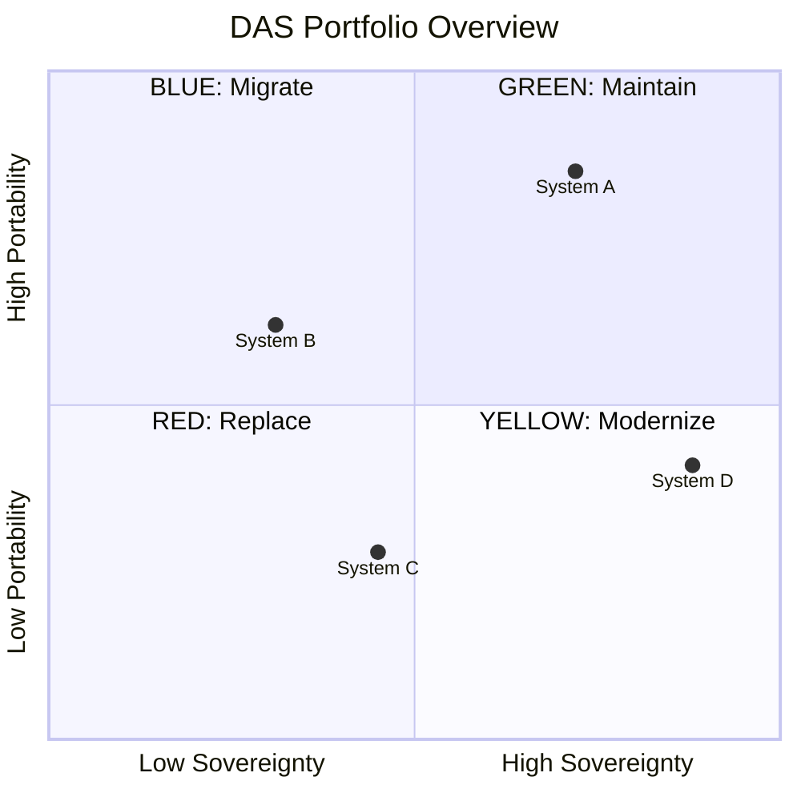

# Mermaid quadrantChart — DAS Visualization

This skill provides the exact syntax and templates for rendering DAS results
as Mermaid `quadrantChart` diagrams. Follow these rules precisely — LLMs
frequently produce subtly broken Mermaid syntax.

---

## quadrantChart Syntax Spec

```
quadrantChart
    title [Chart Title]
    x-axis "Low Label" --> "High Label"
    y-axis "Low Label" --> "High Label"
    quadrant-1 "Top-Right Label"
    quadrant-2 "Top-Left Label"
    quadrant-3 "Bottom-Left Label"
    quadrant-4 "Bottom-Right Label"
    Data Point Name: [x, y]
```

Rules:
- The block starts with `quadrantChart` on its own line (no backtick fence — that wraps the whole block).
- Every subsequent line is indented 4 spaces.
- `x-axis` and `y-axis` use `"Low" --> "High"` with arrow syntax.
- Quadrant numbering follows **math convention**:
  - `quadrant-1` = **top-right**
  - `quadrant-2` = **top-left**
  - `quadrant-3` = **bottom-left**
  - `quadrant-4` = **bottom-right**
- Data points use `Name: [x, y]` where x and y are **floats between 0 and 1**.
- Multiple data points are allowed, one per line.

---

## DAS Coordinate Mapping

Map DAS composite scores (0–10 scale) to quadrantChart coordinates (0–1 scale):

```
x = S_composite / 10
y = CPS / 10
```

Where:
- `S_composite` = Sovereignty composite score (S)
- `CPS` = Portability composite score (CPS)

Example: S = 7.2, CPS = 4.5 → `[0.72, 0.45]`

---

## Single-System Template

Use after assessing a single system:

```mermaid
quadrantChart
    title DAS — [System Name]
    x-axis "Low Sovereignty" --> "High Sovereignty"
    y-axis "Low Portability" --> "High Portability"
    quadrant-1 "GREEN: Maintain"
    quadrant-2 "BLUE: Migrate"
    quadrant-3 "RED: Replace"
    quadrant-4 "YELLOW: Modernize"
    [System Name]: [S/10, CPS/10]
```

Replace `[System Name]` with the actual name and `[S/10, CPS/10]` with computed coordinates.

---

## Portfolio Template

Use when comparing multiple systems in a single chart:



Each system gets its own data point line. Keep names short (truncate if needed) to avoid rendering issues.

---

## Common Mistakes to Avoid

1. **Coordinates out of range.** Values must be 0–1, not raw 0–10 scores. Divide by 10.
2. **Quadrant numbering wrong.** `quadrant-1` is top-RIGHT (not top-left). This trips up most LLMs.
3. **Comments inside the block.** Do NOT use `%%` comments inside a `quadrantChart` block — they break parsing.
4. **Wrong indentation.** Use exactly 4 spaces for all lines after `quadrantChart`. Tabs will break rendering.
5. **Missing quotes on axis labels.** Both axis endpoints need double quotes: `"Low" --> "High"`.
6. **Colon spacing.** Data point syntax is `Name: [x, y]` — a space after the colon is required.

---

## Rendering Compatibility

Mermaid `quadrantChart` renders correctly in:
- GitHub markdown (README, issues, PRs)
- GitLab markdown
- VS Code (with Mermaid extension)
- Obsidian

Wrap the block in a fenced code block with language `mermaid`:

````
```mermaid
quadrantChart
    ...
```
````
