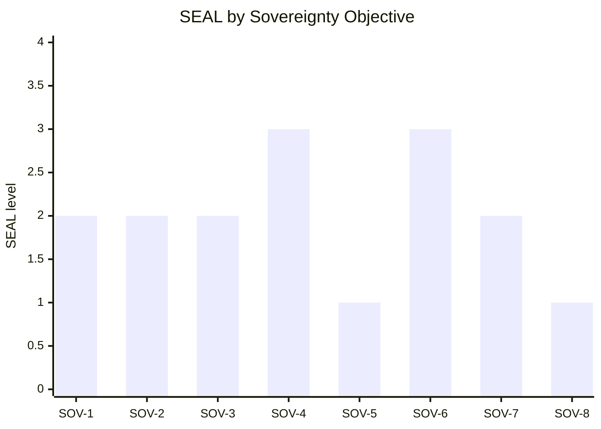

# EU Cloud Sovereignty Framework (SEAL)

This skill operationalises the **European Commission — Cloud Sovereignty Framework,
Version 1.2.1 (Oct. 2025)**, DG Digital Services, Luxembourg.

It is a **complement** to the DAS Sovereignty scale (S1–S3), not a replacement. DAS
asks *"can a foreign entity control, restrict, or compel access?"* on a 0–10 scale.
The EC framework asks a different, procurement-grounded question across **eight
objectives**, each rated on a **five-level assurance scale (SEAL)**. Three of the
eight objectives — **SOV-5 Supply Chain**, **SOV-7 Security & Compliance**, and
**SOV-8 Environmental Sustainability** — are dimensions DAS does not score today.

> **Source note.** The original framework assesses a *cloud service provider* via a
> tender questionnaire, supporting evidence, and public documentation. We adapt it to
> assess a **system / codebase**: code signals (from `das-scanner`) supply part of the
> evidence; the rest comes from a structured interview. Scores are **preliminary** and
> require human review, exactly as with DAS.

---

## How to Use This Reference

1. Gather code signals (via `das-scanner`) and interview answers.
2. For each of the 8 objectives, read the **contributing factors** and the
   **per-objective SEAL rubric**, then assign a SEAL level (0–4) with cited evidence
   and a confidence level.
3. Apply the **material-weakness rule**: an objective's SEAL level is capped by its
   weakest material contributing factor (weakest-link, mirroring DAS cap rules).
4. Compute the **weighted Sovereignty Score (%)** and the **minimum SEAL**.
5. Generate **per-objective recommendations** to raise each objective by one level.
6. Cross-reference: `region-jurisdiction` (regions → jurisdiction), `vendor-db`
   (vendor HQ/ownership), `eu-regulatory` (SOV-7 compliance), `governance-db`
   (SOV-1/SOV-6 governance).

---

## 1. The 8 Sovereignty Objectives

| # | Objective | Focus |
|---|-----------|-------|
| **SOV-1** | Strategic Sovereignty | Degree to which the service is anchored in the EU legal, financial, and industrial ecosystem: ownership stability, governance influence, alignment with EU strategic priorities. |
| **SOV-2** | Legal & Jurisdictional Sovereignty | Legal environment, exposure to foreign authority, enforceability of rights; extent to which the service is anchored in EU jurisdiction and insulated from external legal claims. |
| **SOV-3** | Data & AI Sovereignty | Protection, control, and independence of data assets and AI services within the EU: how data is secured, where it is processed, autonomy over AI capabilities. |
| **SOV-4** | Operational Sovereignty | Practical ability of EU actors to run, support, and evolve the technology independently of foreign control: continuity, skills, resilience. |
| **SOV-5** | Supply Chain Sovereignty | Geographic origin, transparency, and resilience of the technology supply chain; extent to which critical components remain under EU control. |
| **SOV-6** | Technology Sovereignty | Openness, transparency, and independence of the technological stack: interoperability, auditability, freedom from proprietary lock-in. |
| **SOV-7** | Security & Compliance Sovereignty | Extent to which security operations, compliance obligations, and resilience measures are controlled within the EU. |
| **SOV-8** | Environmental Sustainability | Autonomy and resilience over the long term in relation to energy usage, dependency, and raw-material scarcity. |

### Contributing factors (per objective)

**SOV-1 Strategic**
- Bodies with decisive authority over the service located within EU jurisdiction.
- Assurances against change of control.
- Reliance on EU-sourced financing.
- Extent of investment, jobs, and value creation within the EU.
- Involvement in EU initiatives; consistency with EU digital/green/industrial sovereignty objectives.
- Ability to sustain secure operations if vendor support is withdrawn or a request to cease/suspend the service is issued.

**SOV-2 Legal & Jurisdictional**
- National legal system governing the provider's operations and contracts.
- Exposure to non-EU laws with cross-border reach (e.g., US CLOUD Act, Chinese Cybersecurity Law).
- Legal/contractual/technical channels through which non-EU authorities could compel access.
- Applicability of international regimes restricting usage or transfer.
- Jurisdiction where IP is created, registered, and developed (EU vs. third countries).

**SOV-3 Data & AI**
- Only the customer (not the provider) holds effective control over cryptographic access to data.
- Visibility into when/where/by whom data is accessed; auditability of AI model usage; verifiable irreversible data deletion.
- Strict confinement of storage and processing to EU jurisdictions, with no fallback to third countries.
- Extent to which AI models and data pipelines are developed, trained, hosted, and governed under EU control.

**SOV-4 Operational**
- Ease of migrating workloads / integrating with EU-controlled alternatives without lock-in.
- Capacity for EU operators to manage, maintain, and support without non-EU vendor involvement.
- Existence of an EU-based talent pool able to operate the service.
- Operational support delivered from within the EU and subject only to EU law.
- Availability of full documentation, source code, and operational know-how for long-term autonomy.
- Location and legal control of critical suppliers/subcontractors.

**SOV-5 Supply Chain**
- Geographic source of key physical parts; hardware manufacturing/assembly location.
- Jurisdiction and provenance of embedded code / firmware.
- Origin of software: where and by whom it is architected and programmed; jurisdiction governing packaging, distribution, and updates.
- Degree of reliance on non-EU vendors, facilities, or proprietary technologies.
- Visibility into the entire supplier/sub-supplier chain, including audit rights.

**SOV-6 Technology**
- Integration via well-documented, non-proprietary APIs/protocols; adherence to publicly governed, widely adopted standards.
- Software available under open licenses with rights to audit, modify, redistribute.
- Visibility into design and functioning (architecture docs, data flows, dependencies).
- EU independence in high-performance computing (processors, accelerators, software ecosystems).

**SOV-7 Security & Compliance**
- EU/internationally recognised certifications (ISO, ENISA schemes).
- Adherence to GDPR, NIS2, DORA, and other EU frameworks.
- SOCs and response teams operating exclusively under EU jurisdiction; customer/EU oversight of logs, alerts, monitoring.
- Transparent, timely, EU-compliant breach/vulnerability reporting; ability to develop, test, and apply patches independently of non-EU vendors.
- Capacity for EU entities to perform independent security/compliance audits with full access.

**SOV-8 Environmental Sustainability**
- Energy-efficient infrastructure (e.g., low PUE) with measurable improvement targets.
- Circular-economy practices (reuse, refurbishment, responsible end-of-life of hardware).
- Transparent measurement and disclosure of carbon emissions, water usage, and other indicators.
- Sourcing of renewable / low-carbon energy.

---

## 2. The 5 SEAL Levels

| Level | Name | Definition |
|:-----:|------|------------|
| **SEAL-0** | No Sovereignty | Service, technology, or operations under exclusive control of non-EU third parties, governed entirely in non-EU jurisdictions. |
| **SEAL-1** | Jurisdictional Sovereignty | EU law formally applies with **limited practical enforceability**; service/technology/operations under exclusive control of non-EU third parties. |
| **SEAL-2** | Data Sovereignty | EU law applicable **and enforceable**, with **material non-EU dependencies remaining**; under *indirect* control of non-EU third parties. |
| **SEAL-3** | Digital Resilience | EU law applicable and enforceable; EU actors exercise **meaningful but not full** influence; under *marginal* control of non-EU third parties. |
| **SEAL-4** | Full Digital Sovereignty | Technology and operations under **complete EU control**, subject only to EU law, with **no critical non-EU dependencies**. |

The framework uses the SEAL level as a **Minimum Assurance Level**: a tender defines a
minimum SEAL per objective, and a provider failing it on any objective is rejected. We
mirror this with the **minimum SEAL across objectives** (Section 5).

---

## 3. Weights & Sovereignty Score

### Objective weights

| Objective | Weight |
|-----------|:------:|
| SOV-1 Strategic | 15% |
| SOV-2 Legal & Jurisdictional | 10% |
| SOV-3 Data & AI | 10% |
| SOV-4 Operational | 15% |
| SOV-5 Supply Chain | 20% |
| SOV-6 Technology | 15% |
| SOV-7 Security & Compliance | 10% |
| SOV-8 Environmental Sustainability | 5% |
| **Total** | **100%** |

The weighting reflects that procurement procedures already contain strong safeguards for
SOV-2 (Legal) and SOV-7 (Security), so those carry lower weight; SOV-5 (Supply Chain)
carries the highest weight.

### Original formula

```
Sovereignty Score = Σ (n=1..8)  [ Score(SOVn) / Max.Score(SOVn) ] × Weight(SOVn) %
```

### Adapted formula (this plugin)

The original `Score(SOVn)` is the points a tenderer earns on the SOV-tagged questionnaire
questions — evidence we do not have when assessing a codebase. We substitute the assessed
**SEAL level** as each objective's normalised score, with `Max = 4` (SEAL-4):

```
Sovereignty Score % = Σ (n=1..8)  ( SEAL_n / 4 ) × Weight_n
```

> **State this adaptation explicitly wherever the score appears.** A SEAL-4 on every
> objective yields 100%. The score is *complementary* to — and never overrides — the
> per-objective SEAL levels and the minimum SEAL.

**Worked example** (illustrative):

| Objective | SEAL | SEAL/4 | Weight | Contribution |
|-----------|:----:|:------:|:------:|:------------:|
| SOV-1 | 2 | 0.50 | 15% | 7.5% |
| SOV-2 | 2 | 0.50 | 10% | 5.0% |
| SOV-3 | 2 | 0.50 | 10% | 5.0% |
| SOV-4 | 3 | 0.75 | 15% | 11.25% |
| SOV-5 | 1 | 0.25 | 20% | 5.0% |
| SOV-6 | 3 | 0.75 | 15% | 11.25% |
| SOV-7 | 2 | 0.50 | 10% | 5.0% |
| SOV-8 | 1 | 0.25 | 5% | 1.25% |
| **Total** | | | **100%** | **≈ 51.25%** |

Minimum SEAL = **1** (SOV-5 and SOV-8).

---

## 4. Per-Objective SEAL Rubric (0–4)

Assign the **highest level all of whose conditions are met**, then apply the
material-weakness cap. When uncertain, score **lower** and mark confidence Low.

### SOV-1 Strategic Sovereignty
| SEAL | Pattern |
|:----:|---------|
| 0 | Vendor wholly non-EU-owned; decisive authority and financing outside the EU; no EU value creation. |
| 1 | Non-EU vendor with an EU sales/legal entity only; control and capital remain non-EU. |
| 2 | EU-incorporated entity but ultimately non-EU controlled (subsidiary / JV with non-EU parent veto); some EU jobs/investment. |
| 3 | EU-controlled with meaningful EU financing, jobs, and EU-initiative involvement; limited residual non-EU influence (e.g., minority stake, licensed core tech). |
| 4 | EU-owned and EU-governed; assured against change of control; can sustain operations if non-EU support is withdrawn. |

### SOV-2 Legal & Jurisdictional Sovereignty
| SEAL | Pattern |
|:----:|---------|
| 0 | Governing law and data location both non-EU (e.g., US `us-east-1` + US vendor); full CLOUD Act / foreign-law exposure. |
| 1 | EU contract law nominally applies but the provider is a non-EU entity with extraterritorial reach (CLOUD Act applies regardless of region). |
| 2 | EU jurisdiction enforceable and EU data residency, but a US-parented vendor or non-EU IP ownership remains (sovereign-cloud JV, EU region of a US hyperscaler). |
| 3 | EU-jurisdiction vendor; only marginal non-EU legal exposure (e.g., an adequacy-country sub-processor with contractual safeguards). |
| 4 | EU-only jurisdiction for operations, contracts, and IP; no channel for non-EU authorities to compel access. |

*Anchor to DAS S1 and consult `region-jurisdiction` + `vendor-db`. A US-headquartered vendor caps SOV-2 at 2 even with EU data residency (CLOUD Act).*

### SOV-3 Data & AI Sovereignty
| SEAL | Pattern |
|:----:|---------|
| 0 | Data stored/processed in non-EU jurisdiction; provider holds keys; AI via non-EU APIs with no controls. |
| 1 | EU residency claimed but provider-managed encryption (provider can access); no deletion guarantees; non-EU AI services. |
| 2 | EU residency + EU-enforceable law, but provider-held keys or third-country fallback possible; AI models hosted by non-EU providers. |
| 3 | Customer-controlled keys (BYOK/HYOK) for most data; access auditability; EU-hosted AI models with marginal non-EU pipeline dependency. |
| 4 | Customer holds exclusive cryptographic control; processing strictly EU-confined, no fallback; verifiable deletion; AI developed/trained/hosted/governed in the EU. |

*Consult `data-classification` and `region-jurisdiction`. AI/LLM SDKs (e.g. `openai`, non-EU model endpoints) lower this objective.*

### SOV-4 Operational Sovereignty
| SEAL | Pattern |
|:----:|---------|
| 0 | Fully vendor-managed SaaS; no self-host path; support and operations non-EU. |
| 1 | Self-hosting theoretically possible but undocumented; operations depend on a non-EU vendor. |
| 2 | Self-hosting documented but tied to a non-EU vendor's platform/tooling; some EU support. |
| 3 | Cloud-agnostic deployment; EU operators can run it; EU-based support and talent; marginal non-EU tooling. |
| 4 | Full docs + source + know-how; EU talent pool; EU-only support; no non-EU vendor needed to operate or evolve. |

*Anchor to DAS S2, P4, P5; consult `migration-paths` and `abstraction-patterns`.*

### SOV-5 Supply Chain Sovereignty
| SEAL | Pattern |
|:----:|---------|
| 0 | Hardware, firmware, and software predominantly non-EU; no SBOM; no supply-chain visibility or audit rights. |
| 1 | Some software EU-sourced but critical components (hardware/firmware/updates) non-EU; opaque sub-supplier chain. |
| 2 | Mixed origin; SBOM exists; update distribution under non-EU jurisdiction; partial audit rights. |
| 3 | Predominantly EU-sourced software and update governance; key hardware dependencies identified and mitigated; supplier transparency with audit rights. |
| 4 | EU-controlled across hardware, firmware, software origin, packaging, and updates; full supplier visibility and audit rights. |

*Largely interview-driven. Code signals: dependency origins, package registries, container base images, SBOM presence. Most hardware/firmware factors require the interview.*

### SOV-6 Technology Sovereignty
| SEAL | Pattern |
|:----:|---------|
| 0 | Proprietary, closed stack; vendor-locked APIs; no architectural visibility; non-EU HPC dependency. |
| 1 | Proprietary core with some documented APIs; no rights to audit or modify. |
| 2 | Standards-based interfaces with vendor extensions; source-available or partially open; some lock-in remains. |
| 3 | Open licenses + open standards across most of the stack; good architectural transparency; limited proprietary/HPC dependency. |
| 4 | Fully open, standards-based, auditable, modifiable, redistributable; EU-independent across compute, including HPC. |

*Anchor to DAS S2, P1, P3; consult `governance-db`. Open licenses + OpenAPI/standard protocols raise this objective.*

### SOV-7 Security & Compliance Sovereignty
| SEAL | Pattern |
|:----:|---------|
| 0 | No relevant certifications; non-EU SOC; no EU compliance evidence; patching depends on a non-EU vendor. |
| 1 | Some certifications, but security operations and monitoring run from non-EU jurisdiction. |
| 2 | EU compliance (GDPR) + certifications, but SOC or incident response partly non-EU; limited audit access. |
| 3 | EU-jurisdiction SOC/IR; NIS2/DORA alignment where applicable; customer audit rights; mostly EU-independent patching. |
| 4 | Security operations, monitoring, breach reporting, patching, and audits fully under EU control and jurisdiction. |

*Largely interview-driven. Consult `eu-regulatory` for GDPR/NIS2/DORA/CRA/EUCS. Code signals: certification mentions in docs, security tooling, dependency-update automation.*

### SOV-8 Environmental Sustainability
| SEAL | Pattern |
|:----:|---------|
| 0 | No energy/carbon disclosure; no efficiency or circularity practices. |
| 1 | General sustainability claims without measurement or targets. |
| 2 | Some disclosure (carbon/PUE) but no improvement targets or renewable sourcing. |
| 3 | Measured PUE with improvement targets; partial renewable sourcing; some circular-economy practices. |
| 4 | Low PUE with targets; majority renewable/low-carbon energy; full circular-economy and transparent disclosure of carbon/water. |

*Entirely interview/documentation-driven — code analysis cannot assess this objective. If no information is available, score 0–1 and mark confidence Low.*

---

## 5. DAS → SOV Crosswalk

Use this to reuse DAS signals and to explain the relationship in the report.

| SOV objective | Primary DAS source | Key signals / skills |
|---------------|--------------------|----------------------|
| SOV-1 Strategic | S3 (Governance) | vendor HQ/ownership (`vendor-db`), foundation affiliation (`governance-db`); EU financing/jobs → **interview** |
| SOV-2 Legal & Jurisdictional | **S1 (Legal)** | regions (`region-jurisdiction`), vendor domains, vendor HQ (`vendor-db`); IP jurisdiction → **interview** |
| SOV-3 Data & AI | S1 + P2 (Data) | DB type & region, AI/LLM SDKs, encryption/key config; key control, deletion, AI hosting → **interview** |
| SOV-4 Operational | S2 + P4 + P5 | self-host docs, IaC portability, K8s/Helm (`migration-paths`); EU support/talent → **interview** |
| SOV-5 Supply Chain | *(new)* | dependency origins, base images, SBOM; hardware/firmware/update jurisdiction → **interview** |
| SOV-6 Technology | S2 + P1 + P3 | license, open APIs/standards, abstraction (`abstraction-patterns`, `governance-db`); HPC → **interview** |
| SOV-7 Security & Compliance | *(new; uses `eu-regulatory`)* | cert mentions in docs, security tooling; SOC location, audit rights → **interview** |
| SOV-8 Environmental | *(new)* | — (no code signals) → **interview / public docs** |

> **SOV-5, SOV-7, and SOV-8 are not covered by the DAS S/P scores** — this is precisely
> where the EC framework extends DAS. Expect Low confidence on these without an interview.

---

## 6. Interview Question Bank (per objective)

Ask only what code cannot reveal; adapt to the pre-scan. Pick the highest-value questions.

- **SOV-1:** Who ultimately owns/controls the vendor(s)? Is there protection against change of control? What share of financing, jobs, and R&D is in the EU? Are you part of any EU sovereignty initiative (Gaia-X, IPCEI-CIS)?
- **SOV-2:** Under which national law are the contracts governed? Where is the core IP created and registered? Is any vendor US/non-EU headquartered (CLOUD Act exposure)?
- **SOV-3:** Who holds the encryption keys — you or the provider (BYOK/HYOK)? Can you prove irreversible deletion? Where are AI models hosted/trained, and by whom? Any third-country processing fallback?
- **SOV-4:** Could an EU-only team operate and evolve this without the original vendor? Is production support delivered from the EU? Is there an EU talent pool for this stack?
- **SOV-5:** Where is the hardware manufactured? Who controls firmware? Where is software packaged and where do updates originate? Do you have an SBOM and supplier audit rights?
- **SOV-6:** Are core components open-source with rights to modify/redistribute? Any dependency on non-EU HPC (GPUs/accelerators/proprietary silicon)?
- **SOV-7:** Which certifications hold (ISO 27001, SOC 2, ENISA/EUCS)? Are GDPR/NIS2/DORA applicable and met? Where is the SOC / incident-response team? Can you patch independently of non-EU vendors? Do you have full audit access?
- **SOV-8:** Do you have PUE figures and improvement targets? What share of energy is renewable? Any circular-economy / hardware end-of-life practices? Is carbon/water usage disclosed?

---

## 7. Recommendation Generation

For each objective **below SEAL-3** (or below the target level the user set), produce a
concrete *next-level* recommendation: state the current level, the target (current + 1),
and the specific action grounded in the contributing factor that is capping the level.

Template:

> **SOV-n ([objective]): SEAL-[current] → SEAL-[current+1]**
> *Capping factor:* [the weakest contributing factor].
> *Action:* [specific, evidence-grounded step]. *Effort:* [low/medium/high].

Examples:
- **SOV-2: SEAL-2 → SEAL-3** — *Capping factor:* US-parented vendor. *Action:* migrate the data layer to an EU-jurisdiction provider (see `migration-paths`) or a sovereign-cloud JV with operational independence. *Effort:* high.
- **SOV-5: SEAL-1 → SEAL-2** — *Capping factor:* no supply-chain visibility. *Action:* generate and publish an SBOM (CycloneDX/SPDX), pin EU-mirrored package registries, document update provenance. *Effort:* low.
- **SOV-7: SEAL-2 → SEAL-3** — *Capping factor:* non-EU SOC. *Action:* contract EU-jurisdiction managed detection & response; align incident reporting with NIS2 Art. 23 timelines (see `eu-regulatory`). *Effort:* medium.
- **SOV-8: SEAL-0 → SEAL-1** — *Capping factor:* no disclosure. *Action:* obtain PUE and energy-mix figures from your hosting provider and set a measurable improvement target. *Effort:* low.

Ground SOV-7 recommendations in `eu-regulatory` (GDPR/NIS2/DORA/CRA/EUCS). Ground SOV-4
migration recommendations in `migration-paths`.

---

## 8. Report Output Template

Produce the report in this structure (the `das-seal-assessor` assembles it):

~~~markdown
# Cloud Sovereignty Framework (SEAL) Assessment — [System Name]

**Assessed:** [date] · **Framework:** EC Cloud Sovereignty Framework v1.2.1 (Oct. 2025)
**Confidence:** Preliminary (automated scan + interview — human review required)
**Note:** Complement to the DAS Sovereignty (S) score, not a replacement.

## Summary

| | Value |
|---|---|
| **Sovereignty Score** | **[XX]%** (adapted: Σ (SEALₙ/4) × Weightₙ) |
| **Minimum SEAL** | **SEAL-[k]** ([objective(s)] — the Minimum Assurance Level) |
| **Strongest objective** | SOV-[n] ([name]) at SEAL-[k] |
| **Weakest objective** | SOV-[n] ([name]) at SEAL-[k] |

## SEAL by Objective

| # | Objective | Weight | SEAL | Level | Confidence |
|---|-----------|:------:|:----:|-------|:----------:|
| SOV-1 | Strategic | 15% | `███░░` | 2 — Data Sovereignty | Medium |
| SOV-2 | Legal & Jurisdictional | 10% | ... | ... | ... |
| ... | ... | ... | ... | ... | ... |
| SOV-8 | Environmental | 5% | ... | ... | ... |

*(SEAL block: render the level 0–4 as filled/empty cells out of 5, e.g. SEAL-2 → `███░░`.)*

### Visualization (optional)



## Objective Detail

### SOV-1 Strategic Sovereignty — SEAL-[k]
**Confidence:** [High/Medium/Low]
**Evidence:**
- [signal or interview answer] → [how it maps to the level]
**Capping factor:** [weakest contributing factor, or "none — full level"]

[... repeat for SOV-2 .. SOV-8 ...]

## Recommendations (to raise the SEAL level)

### Priority (lowest SEAL × highest weight first)
- **SOV-5 (Supply Chain): SEAL-1 → SEAL-2** — *Capping factor:* ... *Action:* ... *Effort:* ...
- ...

## Relationship to DAS
[1–3 sentences relating the SEAL picture to the DAS Sovereignty (S) score, if available —
e.g. which DAS sub-dimensions drove SOV-2/3/4/6, and which objectives (SOV-5/7/8) DAS did
not cover.]

## Limitations
- SOV-5, SOV-7, SOV-8 rely heavily on interview/public documentation; code analysis cannot fully assess them.
- SEAL levels are preliminary and require human review before use in procurement or compliance decisions.
- The adapted Sovereignty Score substitutes SEALₙ/4 for the EC's tender-question points.
~~~
